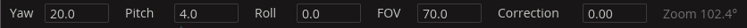

# rOsmo360 user guide

rOsmo360 plays and edits 360° video from the **DJI Osmo 360**. It reads the camera's `.OSV` files directly, stitches the two lenses, keeps the horizon level, and lets you look around, cut clips together, move the camera's view with keyframes, add crossfades, music, colour effects, titles and logos, and export a finished video. Footage filmed in D-Log M is recognised and turned into normal colours with DJI's LUT. Ordinary videos (from a phone, a drone or an action camera) and photos go in the same edit.

Part 1 walks through the app itself; everything there is done with the mouse and keyboard. Part 2 covers the command line, for batches, scripts and a few extra tools. For building rOsmo360 from source, see the [README](../README.md).

**Contents**

Part 1: Using rOsmo360

1. [Getting started](#1-getting-started)
2. [The window](#2-the-window)
3. [Watching a clip](#3-watching-a-clip)
4. [Projections](#4-projections)
5. [Stabilisation](#5-stabilisation)
6. [Building an edit on the timeline](#6-building-an-edit-on-the-timeline)
7. [Keyframes: moving the camera](#7-keyframes-moving-the-camera)
8. [Crossfades](#8-crossfades)
9. [Music and sound](#9-music-and-sound)
10. [Effects: colour, opacity and fades](#10-effects-colour-opacity-and-fades)
11. [Titles and overlays](#11-titles-and-overlays)
12. [Framing: the aspect lock](#12-framing-the-aspect-lock)
13. [Projects](#13-projects)
14. [Exporting video](#14-exporting-video)
15. [Saving photos](#15-saving-photos)
16. [Settings](#16-settings)
17. [Keyboard shortcuts](#17-keyboard-shortcuts)
18. [Tips and troubleshooting](#18-tips-and-troubleshooting)

Part 2: Advanced

19. [The command line](#19-the-command-line)
20. [The clip cache](#20-the-clip-cache)

---

# Part 1: Using rOsmo360

## 1. Getting started

### Installing

For the install script and the AppImage, install `ffmpeg` from your distribution first (`sudo apt install ffmpeg`, `sudo dnf install ffmpeg` or `sudo pacman -S ffmpeg`). Then take one of the ready-made builds from the [releases page](https://github.com/ravelund/rOsmo360/releases/latest). They run on x86_64 Linux: Ubuntu 22.04, Debian 12, Fedora 36 and newer.

- **Install script**: puts rOsmo360 in your application menu. Paste this into a terminal:

  ```sh
  curl -fsSL https://github.com/ravelund/rOsmo360/releases/latest/download/install.sh | sh
  ```

  Run it again to update. Adding `--uninstall` removes it; your settings stay.
- **AppImage**: download `rOsmo360-x86_64.AppImage`, make it executable (in your file manager's properties, or `chmod +x rOsmo360-x86_64.AppImage`) and double-click it.
- **Flatpak**: download `rOsmo360-x86_64.flatpak` and open it with your software centre (Discover, GNOME Software), or install it in a terminal with `flatpak install --user rOsmo360-x86_64.flatpak`. It brings everything it needs, ffmpeg included, so you can skip installing ffmpeg. Its exports are a little slower on NVIDIA cards.

On an Apple Silicon Mac, rOsmo360 can be built from source for now; see the [README](../README.md#building).

### What you need

- Clips from the Osmo 360 (`.OSV`), in any of its video modes, 100 fps included. Copy the `.LRF` file that the camera records next to each clip as well. It's a small preview version, and rOsmo360 uses it for smooth playback, scrubbing and thumbnails.
- If you like, ordinary videos and photos to mix in: MP4, MOV, MKV and the like, and JPG, PNG, WebP, BMP or TIFF (see [Ordinary videos and photos](#ordinary-videos-and-photos)).
- A GPU with up-to-date drivers (Vulkan on Linux, Metal on a Mac). It decodes the video, draws the view and renders exports.

### Opening clips

Start **rOsmo360** from your application menu.


**Open clips…** picks one or more clips (Osmo clips, ordinary videos or photos); **Open project…** opens a saved edit; **Add music…** starts a project from a song (see [Music and sound](#9-music-and-sound)). A bar shows how far loading has got. The first time, a clip takes a while to open, longest from a network drive or a spinning disk, because rOsmo360 reads the camera's motion data from all through the file. It remembers what it read, so the same clip opens almost at once after that, in any project.

The first clip starts playing as soon as it has loaded; the others load behind it.

## 2. The window


From top to bottom:

1. **The top bar**: projects, clips, the picture's settings, the export and what is playing.

   

   The icons, from the left: **settings** (a cog; see [Settings](#16-settings)), **new project** (a page with a plus), **add clips** (a film strip with a plus), **add music** (a note with a plus), **add overlay pictures** (a picture with a plus) and **add text** (a T with a plus; see [Titles and overlays](#11-titles-and-overlays)), **open a project** (a folder), **save** (a diskette; dimmed when there's nothing new to save) and **save as** (a diskette with a pencil). Then the **Aspect** of the picture, and **export** (an arrow out of a tray), which opens the [Export panel](#14-exporting-video). While an export or a colour track runs, its progress shows here, with a crossed circle to stop it.

   Next come the cut's **Stabilisation** and **Projection** pickers, the playback **Source** and the **Full res** switch (see [Watching a clip](#3-watching-a-clip)). Ordinary videos and photos have neither stabilisation nor projection, so those are left out while one plays.

   On the right are the **audio meter** (see [The audio meter](#the-audio-meter)), **fullscreen** (corners) and two dimmed icons that say what you're seeing (a film strip for the quick preview version, a picture for the full video, an hourglass while a sharp paused frame loads) and how the video is decoded (a lightning bolt when the GPU does it). Messages, such as where an export went, appear beside them.

2. **The view**, where you look around, with panels either side when you open them (see below). The thin bar under it, with a short grip in the middle, shares the window between the picture and the timeline: drag it up to make the timeline's thumbnails and waveforms bigger, down to give the picture more room. Double-click it to put it back. The size is remembered between runs.

3. **The transport row**: play, photos, the time, the view's keyframes, the cut tools, timeline zoom, and sound.

   

   After the eyedropper come the **FOV** slider (the zoom) and **reset view** (a turn-back arrow), then **Effects** (three sliders; opens the [Effects panel](#10-effects-colour-opacity-and-fades)) and **crossfade** (two overlapping frames; see [Crossfades](#8-crossfades)). The **speaker** on the right opens the [Audio panel](#9-music-and-sound); it shows a cross while muted.

4. **The view angles**: the view as numbers, for typing a framing in exactly (see [Typing the view](#typing-the-view)). Settings can hide this row.

5. **The timeline**, from the top: the **Text** lane and the **Overlay** lane (once they have something in them, each with its own keyframe rows), the cuts of your edit with thumbnails, their **Effects** and **View** keyframe rows, the seek bar, and the music lane.

   

   On the cuts, an **X** marks a crossfade and a light-blue line a cut's own sound level. Each track's keyframes sit in faint rows under it, named at the left: **View** for the camera's keyframes (see [Keyframes](#7-keyframes-moving-the-camera)), **Effects** for colour ([Effects](#10-effects-colour-opacity-and-fades)), and **Motion** for where an overlay is ([Titles and overlays](#11-titles-and-overlays)). Click a mark to jump to it, and drag it to move it to another moment. In the music lane, the orange line is the music's volume.

**Panels** open beside the view as you need them, and close again with the same button or their ✕:

| Panel | Side | Opens with |
|---|---|---|
| [Effects](#10-effects-colour-opacity-and-fades): colour, opacity, fades, rolling shutter | right | **Effects** in the transport row, or **G** |
| [Export](#14-exporting-video): resolution, format, a file per cut | right | **export** in the top bar, or **Ctrl+E** |
| [Audio](#levels): listening volume and the mix | right | the **speaker** in the transport row |
| [Settings](#16-settings): theme, decoding, keyframing | left | the **cog** in the top bar, or **Ctrl+,** |
| [Info](#file-information): what a file is and where it is | left | **right-click** a cut, a song or a picture on the timeline |
| [Text](#the-text-panel): a title's words and look | left | selecting a title |

One panel shows on each side at a time; opening another takes its place.

**Hover over any button** to see what it does and its keyboard shortcut.

## 3. Watching a clip

| To | Do |
|---|---|
| Play or pause | Space, or ▶ |
| Seek | Click or drag on the seek bar; ← / → jump 5 seconds |
| Step one frame (paused) | `,` and `.` |
| Look around | Drag in the view, or use ↑ / ↓ (pitch) and Shift+← / → (yaw) |
| Roll the view | Right-drag, or Q / E |
| Zoom | Scroll in the view, `+` / `-`, or the **FOV** slider |
| Go back to the starting view | 0 or Home, or the turn-back arrow next to FOV |
| Fullscreen | F, or the corners icon at the top right; Esc leaves it |
| Mute | M, or in the Audio panel (the speaker icon), which also sets the volume |

**Source** (in the top bar). Clips play from the `.LRF` proxy by default. It decodes quickly, so playback and scrubbing stay smooth on most computers. On a fast GPU you can play the `.OSV` itself, scaled to 1920 px or at its full 3840 px; an Apple Silicon Mac plays the full `.OSV` smoothly. If there's no `.LRF`, the `.OSV` is used.

**Full res** (the switch beside it, "full resolution when paused"). When this is on, pausing swaps in a sharp full-resolution frame after a moment. Turn it off to keep the paused picture at the playback source's quality. The picture then doesn't jump in sharpness while you set keyframes. Exports always use the full resolution either way.

## 4. Projections

Press **P**, or use the **Projection** picker in the top bar, to switch between three ways of showing the sphere.

**Perspective** is a normal camera view: straight lines stay straight. It's the one for most shots.


**Little planet** wraps the whole sphere into a circle. Looking down (the default) makes a tiny planet with the ground in the middle. Looking up turns it inside out, with the sky in the middle and the landscape around it:


**Equirect** shows the whole sphere flat, as a 2:1 map. It's useful for seeing everything that's around at once.

Perspective and little planet are one family. A keyframed move can morph smoothly from one into the other (see [keyframes](#7-keyframes-moving-the-camera)), and **Correction** in the [view angles](#typing-the-view) sets any mix of the two: 0 is perspective, 1 the little planet's mapping, and in between a wide view whose edges bend a little. Pointed at the horizon, a high correction gives a very wide, fisheye-like shot rather than a planet; at the same FOV, 1 shows twice as much as 0. The Projection picker sets it back to its own value.

## 5. Stabilisation

The camera records its own motion about a thousand times a second, and rOsmo360 uses that to steady the picture.

- **Horizon** (the default) keeps the horizon level and follows where the camera points, smoothed. It looks like a steady camera operator.
- **Level** keeps the horizon level like Horizon, but holds the direction the camera pointed when the clip started, instead of following it. A mountain stays put while the camera turns, and the picture stays level even if the camera started tilted. Use it for a view that should stay on one thing while you turn around.
- **World lock** also holds the view still in the world, but keeps the clip's starting orientation exactly, including any tilt it started with.
- **Off** shows the picture as the camera saw it.

Press **S**, or use the **Stabilisation** picker in the top bar. **Each cut keeps its own mode**: the picker changes the cut that's playing, and new cuts get the mode you used last. On the timeline, a cut that isn't on horizon says so in its label, for example "world lock".

**Rolling shutter** corrects the slight wobble and lean caused by the sensor reading out line by line during fast turns. Leave it on. Press **R**, or use the switch at the bottom of the [Effects panel](#10-effects-colour-opacity-and-fades), to turn it off and on; it applies to the whole edit and the export.

## 6. Building an edit on the timeline

An *edit* is a row of *cuts*, each a stretch of one clip, played one after another. Every clip you open becomes a cut.

- **Add clips**: the film strip with a plus, or Ctrl+O; you can pick several at once. Each is added at the end.
- **Select a cut**: click it in the top row of the timeline.
- **Split**: put the playhead where you want the cut, then press **C** or ✂. Both halves keep the cut's keyframes, so the camera move carries on unchanged.
- **Trim**: drag a cut's left or right edge.
- **Move**: drag a cut sideways; a line shows where it will land.
- **Delete**: select it and press **Shift+Delete**, or 🗑.
- **Undo / redo**: Ctrl+Z and Ctrl+Shift+Z (or Ctrl+Y).

Playback runs through the cuts in order, straight on from one into the next, even when the next one comes from a different clip: rOsmo360 gets the next cut ready a few seconds ahead, so the change is smooth. To dissolve from one cut into the next instead of cutting, see [Crossfades](#8-crossfades).

Each cut shows thumbnails of its footage, the view straight ahead. They fill in a moment after a clip loads; a long clip takes a few seconds the first time.

A cut's label shows its clip and length, its stabilisation when it differs, and its note when there's room. Notes come from the project file, so whoever put the edit together can say what each cut is for; the player shows them but doesn't edit them yet.

### Ordinary videos and photos

Videos from a phone, a drone or an action camera, and photos, go on the timeline as cuts too: add them with **add clips** like any clip. They look and work the same as an Osmo cut: trim, split, move, keyframes, effects, crossfades, volume points and export. What differs:

- **Framing is pan and zoom** within the picture, as there's no sphere to look around in. Drag to pan, scroll or the FOV slider to zoom; a keyframe holds that framing, and keyframes in a row make a pan or a slow zoom. A cut of one without keyframes shows the whole picture.
- **No stabilisation, projection or follow**: the Stabilisation and Projection pickers and the Source picker are left out of the top bar while one plays, and Follow shows "—". Ordinary videos play as they were filmed, portrait ones upright.
- **Size**: videos play at up to 1920 px, and pausing swaps in the full size when it's bigger.
- **HDR video** from a phone (HLG or HDR10) is brought to normal, SDR colours by itself, in the player and the export alike, so it doesn't look washed out. The **10-bit** setting (see [Settings](#16-settings)) keeps its skies smoother.
- **Any frame rate**: a 60 fps phone video plays and exports at the edit's rate (the first Osmo clip's).
- **Photos** have no length of their own: a new one is 5 seconds; trim it to any length. A slow zoom in over a photo (two keyframes) makes a still feel alive. Photos have no sound, and a PNG's see-through parts show black on the main track; for a logo, use the [overlay track](#11-titles-and-overlays) instead.

### File information

**Right-click** a cut, a song or an overlay picture on the timeline for the **Info panel** at the left of the view: what the file is (an Osmo clip, a video, a photo or a song), its length, picture size, frame rate, video and sound formats, when it was recorded, its size on disk, and for an Osmo clip whether its `.LRF` proxy is there. Under that, where it sits in the edit and which part of the file it uses, and the folder it's in.


The two icons at the bottom **show the file in your file manager** (selected, where the file manager supports it) and **copy its full path**. The ✕ closes the panel.

### Zooming the timeline

With a long edit, short cuts and close keyframes get narrow. Zoom in:

- **Scroll** on the timeline to zoom around the mouse pointer.
- **Ctrl+=** / **Ctrl+−**, or the magnifier icons and the slider between them, zoom around the playhead.
- **Ctrl+0**, or the arrows-to-both-ends icon, shows the whole edit again.


When zoomed in, a scrollbar appears under the seek bar. Drag it, use Shift+scroll, or scroll sideways on a touchpad to move along. While playing, the timeline scrolls along to keep the playhead in sight.

## 7. Keyframes: moving the camera

A **keyframe** remembers a view at a moment of a cut: where it looks (yaw, pitch, roll), the zoom, and the projection with its correction. Between keyframes the view moves smoothly from one to the next. That's how you make pans, slow zooms and morphs into a little planet.

1. Go to the moment where the move should start, and frame the view.
2. Press **K**, or the diamond-with-a-plus icon. A mark appears in the cut's **View** row, under its thumbnails.
3. Go to where the move should end, frame the new view, and press **K** again.
4. Play it back.

More:

- **Update a keyframe**: go to it and press K again with the new view.
- **Jump between keyframes**: `[` and `]`, or click a mark.
- **Retime a keyframe**: drag its mark along the View row.
- **Keyframe as you look**: with **Auto keyframe** on (see [Settings](#16-settings)), looking around while paused sets or updates the keyframe at the playhead by itself, without pressing K. Each look-around is one undo step.
- **Delete a keyframe**: go to it and press **Delete**, or the crossed-diamond icon.

**Following and looking.** After you play, seek or change a keyframe, the view follows the keyframes. As soon as you look around by hand, you take over from the view they showed, until the next play or seek. So you can always look around freely without changing anything; only K saves a view (unless Auto keyframe is on).

**Cuts without keyframes** hold the view the edit had last: the view at the end of the nearest cut before them that has keyframes, as after a split. The export frames them the same way.

**Framing a cut by hand keeps it.** Look around in a cut that has no keyframes of its own, and it keeps that view: as soon as you play, seek or go to another cut, the cut gets a keyframe of what you framed at its start (Ctrl+Z takes it away). So it never changes another cut's view, and the export and the saved project frame it as you left it. Ordinary videos and photos keep their own framing apart from Osmo cuts.

Keyframes belong to their cut and stay pinned to the footage. Moving or trimming a cut keeps its camera moves on the same moments. Keyframes trimmed off the end are kept for when you extend the cut again.

### Typing the view

The row under the transport row shows the view as numbers and follows it as it moves:



- **Yaw** turns right, in degrees. Past a full turn it also shows as turns × degrees (373.7 is 1 × 13.7°), as a keyframed spin can go round more than once.
- **Pitch** looks up, **Roll** tilts clockwise.
- **FOV** is the zoom: degrees from the top of the picture to the bottom.
- **Correction** bends perspective towards the little planet (see [Projections](#4-projections)).
- **Zoom** (greyed) is a readout of how wide the picture is from side to side, which a high correction makes much wider than the FOV.

To change one, type a number and press Enter, or **drag its name sideways** (about a degree per 4 pixels), or scroll on its field or use ↑ / ↓ while typing in it. Hold **Shift** for steps ten times finer. A change works as looking around does: with **Auto keyframe** on and the video paused it keys the view at the playhead (each edit one undo step); otherwise press **K** to keep it.

It's the way to give several cuts exactly the same framing: with the camera mounted the same way in each clip, type the same numbers. On an ordinary video or photo the row shows the framing within the picture instead: **Across %** and **Down %** (where the view's centre is, in % of the picture's height from the middle), **Zoom %** (100% shows the whole height) and **Roll**.

While a keyframe follows the stick or a colour track, the numbers are the view as it is on screen; keying it keeps the following.

### Ease: how a keyframe moves on

Each keyframe also says how the view travels from it to the *next* one. Choose it in the **Ease** picker while the playhead is on the keyframe, or press **J** to cycle through the three:

| Ease | Mark | From this keyframe to the next |
|---|---|---|
| **Smooth** | ◆ | Starts gently, moves, and slows into the next keyframe. The default; good for most moves. |
| **Linear** | ● | Moves at a steady speed. Good for an even pan, or for several keyframes in a row that should feel like one move. |
| **Hold** | ■ | Stays still, then jumps to the next keyframe's view when the playhead gets there. A cut to a new angle within one cut. |


Two common patterns:

- **Pause, then pan**: two keyframes with the same view (the first Smooth or Hold), then a third with the new view.
- **Cut between angles**: set a keyframe to Hold, and put the next keyframe, with the other angle, where the cut should happen.

### Follow: a third-person shot

A keyframe can **follow the selfie stick** instead of looking in a fixed direction. The stick points at whoever holds it, so the view keeps you in the picture as you walk, turn and move the stick, like a drone following from above and behind. rOsmo360 knows where the stick points from the camera's own motion data, so it keeps working even when the stick points straight down.

1. Frame the shot you want around yourself: for example tilt the view up a little from the stick so the trail ahead shows too, and widen it (FOV 100 or so).
2. Press **K**, then choose **Stick** in the **Follow** picker. The view stays as it is: the keyframe now keeps it as an offset from the stick. Its mark in the View row gets a ring.
3. Play. Keyframes you add after it follow too, until you set one back to **Fixed**. A move from a following keyframe to a fixed one, or back, eases over as usual.

To follow **someone or something else**, such as a friend in a red jacket, track it by its colour:

1. Pause where the subject is in view, at the keyframe that should start following it.
2. Click the **eyedropper** icon next to the Follow picker, or choose **Colour track** in the picker, and drag a box over the subject. A box over a good patch of the colour works better than a thin edge. Esc cancels.
3. rOsmo360 takes the box's colour and tracks it from there to the end of the cut (the top bar shows **Tracking** with its progress), saves the track next to the project, and makes the keyframe follow it with the subject in the middle. The top bar then says in how many moments it found the colour.

Pick something with a strong colour that nothing big nearby shares: sky, grass, rock and snow won't track. Small things that swing, like legs, follow less steadily than a jacket.

## 8. Crossfades

A crossfade dissolves one cut into the next, picture and sound together, instead of cutting straight across. The second cut starts a little before the first ends, and they blend over that overlap.


- **Add one**: select the later of the two cuts and click **crossfade** (two overlapping frames) in the transport row. It overlaps the cut before by 1 second. Click it again to take the crossfade away.
- **Make it longer or shorter**: hold **Shift** and drag the later cut's left edge. Further left is a longer crossfade, back right a shorter one. (Without Shift, the same drag trims the cut.)
- On the timeline the overlap is marked with an **X**.


The edit gets shorter by each crossfade, since the cuts overlap. No extra footage is needed: the crossfade uses the end of the first cut and the start of the second, as you trimmed them. It can't be longer than either cut allows, and trimming a cut shorter shortens its crossfade to fit. The first cut has none, as nothing comes before it.

**Framing the cut that comes in.** In the overlap, the playhead belongs to the earlier cut, so keyframes and looking around act on that one. To work on the later cut there, click it (on the X, the later cut is on top), with playback paused: the view shows that cut on its own, and K, Delete, `[` `]`, the Ease and Follow pickers and looking around all act on it. Click the earlier cut to switch back. Playing always shows the blend.

During a crossfade the player decodes both cuts at once. On the **Proxy (LRF)** source that's smooth; at OSV 1920 or full size it may lag on most computers, but the export is never affected.

## 9. Music and sound

### Adding music

Click **add music** (the note with a plus) in the top bar, or **Add music…** on the start screen, and pick a song: MP3, FLAC, WAV, M4A, AAC, Ogg or Opus. It goes in the **music lane** under the seek bar, after any music already there, with its waveform drawn in it.

You can start a project from a song alone: it sets the length to fill, and the timeline shows it running on past the video until you've added enough clips. The export always ends with the last cut; music still playing there fades out over its last 3 seconds by itself.

### Arranging the music

The music has its own cuts, apart from the video's. It stays where you put it on the timeline when you move, trim or crossfade video cuts.

- **Select** a song by clicking it in the lane.
- **Move** it by dragging. It snaps to cut boundaries, the playhead and the other songs' edges. A song pushed into another stops edge to edge against it, and jumps to the other side once you drag past halfway.
- **Trim** it by dragging its left or right edge. Trimming the start keeps the rest of the song where it is in the edit.
- **Split** it at the playhead with **C** or ✂ while it's selected, to rearrange or drop part of it.
- **Delete** it with **Delete** (or Shift+Delete, or 🗑) while it's selected.
- **Crossfade two songs**: hold **Shift** while dragging one onto the other, or while dragging an edge into it. The overlap becomes the crossfade, marked with an X, and the two songs trade places at an even loudness through it.

### Levels

Click the **speaker** at the right of the transport row for the **Audio panel**.


- **Listening**: mute and how loud you listen. It changes only what you hear, not the export or the meter.
- **Clip sound**: the sound recorded with the clips, all cuts together, in dB (0 is as recorded, the far left is silence). Lower it (−6 to −12 dB) under music.
- **Music**: the whole music track.

### The audio meter

The meter on the right of the top bar shows the mix as it plays: a bar each for left and right, the faint part the peaks and the solid part the average (RMS). It turns yellow from −6 dB and red past 0 dBFS, where the export's sound would clip; a mark holds each recent peak a moment. The number beside it is the loudest peak since you pressed play, in dBFS, and stays there after you pause, red if it went over 0.

It measures what the export mixes: the clips' sound and the music at their levels, volume points and crossfades included, whatever the listening volume and mute are set to. If it goes red, lower **Clip sound** or **Music** a little, or dip the loud stretch with a volume point.

### Volume points

For a level that changes over time, such as music dipping under someone talking, add **volume points**.

- **On the music**: **Ctrl+click** in the music lane adds a point where you click; keep holding to drag it straight away. Or select a song and press **K** for a point at the playhead. An orange line joins the points.
- **On a cut's own sound**: **Ctrl+click** on the cut in the top row. A light-blue line over the cut joins its points. They belong to the cut's footage, like its keyframes, so a shout keeps its level wherever you move the cut.
- **Drag** a point up or down for its level and sideways for its time; it shows its value as you drag, and snaps to 0 dB.
- **Delete** a selected point with **Delete**.

The level runs in a straight line between points, and stays at the first and last point's level before and after them. Points work on top of the sliders, so the slider still turns everything up or down together.

## 10. Effects: colour, opacity and fades

Click **Effects** (three sliders) in the transport row, or press **G**, to open the Effects panel beside the view. It shows the effects of the cut under the playhead, or of the selected title or overlay while it's showing (see [Titles and overlays](#11-titles-and-overlays)).

![The Effects panel for cut 1, a clip filmed in D-Log M, with a ✕ at the top to close it: the LUT picker on DJI Osmo 360 D-Log M to Rec.709 V1 with its Strength at 100 %; sliders for Exposure (+0.25 EV), Contrast, Highlights, Shadows, Temperature, Tint, Saturation, Vibrance (+0.15), Vignette and Opacity (100 %), each with its value and a reset arrow; below them the add-keyframe and delete-keyframe icons, the Ease picker, white balance, to all cuts and reset; the edit's Fade in and Fade out; and Correction, with the Rolling shutter switch](guide/effects-panel.png)

| Effect | What it does |
|---|---|
| **Exposure** | Brighter or darker, in stops, like the camera's EV. Brightening rolls the highlights off gently instead of burning them out, so a sky keeps its colour |
| **Contrast** | More or less contrast, around mid-grey |
| **Highlights** | Pull back (−) or lift the bright parts, such as a bright sky |
| **Shadows** | Lift (+) or deepen the dark parts |
| **Temperature** | Cooler (−) or warmer (+) |
| **Tint** | Greener (−) or more magenta (+) |
| **Saturation** | Less or more colour; all the way down is black and white |
| **Vibrance** | More colour mostly where there's little, sparing what's already colourful |
| **Vignette** | Darker corners |
| **Opacity** | How much shows: less fades the cut towards black (an overlay towards see-through) |

The turn-back arrow next to a value sets it back to none. A little goes a long way: exposure ±0.3, highlights −0.3 under a bright sky, and some vibrance are often all a shot needs.

**Effects are keyframed**, like the view, with their own keyframes:

- Moving a slider sets the effect keyframe at the playhead, making one there if there isn't one. A cut with a single effect keyframe has that look all the way through; add another further on, with other values, and the look changes smoothly from one to the next.
- The **add keyframe** icon in the panel adds one at the playhead without changing anything, and the **delete** icon removes the one there. The **Ease** picker sets how it moves on to the next: smooth, linear or hold.
- On the timeline, effect keyframes are marks in the **Effects** row under their cut. Click one to jump to it, or drag it to move the change to another moment.

More in the panel:

- **White balance** (the eyedropper): draw a box over something that should be grey or white, such as snow or a cloud. Temperature and tint are set to make it neutral.
- **To all cuts** (two film frames with a plus): gives every other cut the look at the playhead, so a whole edit can share one grade.
- **Reset** (the turn-back arrow): removes all of this cut's effects.
- **Fade in** and **Fade out**: fade the whole edit from black at its start and to black at its end, the sound with the picture.
- **Rolling shutter**, under Correction: the correction of the sensor's line-by-line readout (see [Stabilisation](#5-stabilisation)), for the whole edit.

**Opacity** fades a cut out and in within the edit: ease it from 100% to 0% over a second for a fade to black between two cuts, or use it on a title or logo to fade it in and out. For the edit's own start and end, use the fades.

Effects apply to the framed picture after stitching, so what you see in the player is what the export gives, and a crossfade blends two graded cuts. Press **G** again, click the Effects icon, or click the **✕** at the top of the panel to close it.

### LUTs and D-Log M

A LUT (a `.cube` file) turns the picture's colours into others. Its main use here is **D-Log M**, the Osmo 360's flat colour profile, which keeps more of the bright and dark parts but looks grey and washed out until it's converted. DJI's **Osmo 360 D-Log M to Rec.709 LUT** turns it into normal colours. Any other `.cube` LUT works too, such as a creative look.

#### Downloading and adding DJI's LUT

You do this once on each computer. rOsmo360 doesn't come with the LUT, as it's DJI's file to hand out, but it's a free download.

1. **Download it.** Open DJI's download page, [Osmo 360 D-Log M to Rec.709 LUT](https://www.dji.com/downloads/softwares/osmo-360-dlog-m-to-rec709-lut) (in the DJI Download Center, search for "Osmo 360 D-Log M" if the link has moved), and click the **.cube** button. The page has a **Mac** and a **Windows** tab; it doesn't matter which you pick, as both give the same file, and on Linux either will do. You get `DJI Osmo 360 D-Log M to Rec.709 V1.cube`, about 1 MB, usually in your Downloads folder. Make sure it's the **Osmo 360** one (it's for the Osmo 360 II too): DJI has D-Log M LUTs for its drones and other cameras as well.
2. **Add it.** In rOsmo360, open **Settings** (the cog at the far left of the top bar, or **Ctrl+,**), find **LUTs** and click **Add LUT…**. Pick the `.cube` file you downloaded and click **Open**.

   

3. **Check it.** The LUT is now listed under LUTs, and **For D-Log M clips** shows it: since its name says D-Log M, rOsmo360 chose it for those clips by itself. Any D-Log M clips in your edit change from grey and flat to normal colours at once.

   

rOsmo360 copies the file into its own settings folder, so you can delete the download afterwards, and your projects keep working wherever the download went. The LUT is known by its file name (without `.cube`); a project made on another computer finds it by that name, so add the same file there without renaming it. To take a LUT out of the library, click the **✕** beside it.

From then on, every clip filmed in D-Log M gets the LUT as soon as you add it to the edit. rOsmo360 knows from the clip itself whether it was filmed in D-Log M; the camera's file says so even though it's otherwise tagged like any video.

#### Using it

At the top of the Effects panel, for the cut under the playhead:

- **LUT** picks the cut's LUT, or **None**. "filmed in D-Log M" shows beside it for such clips.
- **Strength** sets how much of it applies: 100 % is all of it, less mixes in the picture as filmed. It's keyframed with the other effects, so a LUT can fade in over a cut, from the flat log picture to full colour.

The LUT applies first and the effects after it, so exposure, white balance and the rest work on the converted colours, as on any other clip. If a project names a LUT this computer doesn't have, the project still opens: those cuts show as filmed, and the player says which LUT is missing. Add it in Settings under the same name and they get it back.

You don't need the **10-bit** setting for D-Log M: the camera always records 10 bits, and on test footage the converted picture came out as smooth decoded at 8 bits. Turn it on for a final export if a clean sky shows bands.

## 11. Titles and overlays

Above the main picture are two more tracks: **Overlay**, for pictures such as a logo or a map, and **Text**, for titles and captions, on top of everything. Both are in edit time, like the music: they stay where they are on the timeline when you move or trim cuts.


### Adding them

- **Add text** (the T with a plus in the top bar) puts a title at the playhead, 5 seconds long, in bold white Inter with a soft shadow, and opens the **Text panel** at the left of the view.
- **Add overlay pictures** (the picture with a plus) picks one or more pictures and puts them at the playhead, 5 seconds each, one after another. PNGs keep their see-through parts.

On the timeline each item is a block: teal for text, orange for pictures. Click one to select it; drag it to move it and its edges to change how long it shows; **Delete** removes the selected one. Items on one lane never overlap: one pushed into another stops against it, and jumps past once you drag over halfway. Click the empty lane to deselect.

### The Text panel

With a title selected, the panel at the left of the view holds:

- **The words**: type them in the box; Enter starts a new line.
- **The font**, and **Bold** where the font has it. The first six come with rOsmo360 and are marked **built in**: they look the same on any computer. **Inter** (clean, the default), **Montserrat** (geometric), **Bebas Neue** (tall capitals for titles), **Playfair Display** (an elegant serif), **Caveat** (handwriting) and **Permanent Marker** (a marker pen). The rest of the list is your computer's own fonts; a project using one that another computer lacks shows Inter there, and says which font is missing.
- **Size**, the letters' height as a share of the picture's.
- **Lines**: left, centred or right, for text over several lines.
- **Colour**, from the swatches.
- **Shadow** (soft, behind the letters) and **Outline** with its width and colour. White with a shadow reads over most footage; an outline helps over busy, bright ground such as snow.

The ✕ at the top closes it, deselecting the title.

### Placing them

Pause with a title or picture showing, and select it. A box with corner squares and a knob above it appears around it in the view:

- **Drag it** to move it. Its centre snaps to the middle of the picture when it comes close.
- **Drag a corner** to make it bigger or smaller, about its centre.
- **Drag the knob** to turn it. Hold **Shift** to turn in 15° steps.
- **Click another** title or picture in the view to select it (where it shows: the see-through parts of a picture don't count, so you can still look around past it).

The same settings are sliders at the top of the [Effects panel](#10-effects-colour-opacity-and-fades) while an item is selected: **Across**, **Down**, **Size** and **Rotation**, with the item's own effects below them. Use **Opacity** there to fade a title in and out.

**They move with keyframes.** Every change of place sets a **motion** keyframe at the playhead, shown in the item's **Motion** row; set a different place further on and the item moves there smoothly, eased like the camera's keyframes. Drag a mark in the Motion or Effects row to move it to another moment. The Effects panel's keyframe buttons and Ease picker act on the item's motion and effects together. A title with one keyframe stays put.

Overlays are drawn over the graded picture, and the edit's fades cover them too. The export burns them in exactly as the player shows them; **Clips** export leaves them out, for the other editor to add.

## 12. Framing: the aspect lock

The **Aspect** picker in the top bar sets the shape of the picture: Free, 16:9, 9:16, 4:3, 1:1 or 2:1. The view is letterboxed to that shape, so you frame exactly what will be exported. Use 9:16 for phone video such as Reels, Shorts or TikTok:


Exports and saved views take the same shape. With **Free**, exports are 16:9.

## 13. Projects

A project saves the edit: the cuts, their keyframes, stabilisation, crossfades, effects and sound levels, the music, the titles and overlays, the fades, and the aspect lock.

- **Save**: Ctrl+S, or the diskette. **Save as**: Ctrl+Shift+S, or the diskette with a pencil.
- **Open**: Ctrl+Shift+O, or the folder.
- **New**: Ctrl+N, or the page with a plus, starts an empty project without closing the window. Clips you had open stay loaded, so adding them again is instant.

**The view you framed is kept.** If you frame cuts by dragging the view but set no keyframe, saving gives the first of them a keyframe of that view, so the project opens, and exports, framed as you left it (see [Keyframes](#7-keyframes-moving-the-camera)).

Changing the **Aspect** counts as a change to save too.

The window title shows the project's name, with a dot (•) when there are unsaved changes. If you close the window, open another project or start a new one with unsaved changes, rOsmo360 asks whether to **Save**, **Don't save** or **Cancel**.

Clips in the project's folder, or in folders inside it, are remembered by relative path, so you can move the whole folder, or copy it to another computer, and the project still finds its clips. If a clip is missing when you open a project, its cuts are left out and you're told which.

A project starts playing as soon as its first cut's clip has loaded; the others load behind it, with the bar in the top bar. If playback reaches a cut whose clip isn't in yet, it waits there.

## 14. Exporting video

Click **export** (an arrow out of a tray) in the top bar, or press **Ctrl+E**, for the **Export panel** at the right of the view.


1. **Resolution**: 720p, 1080p (the default, good for sharing online), 1440p or 2160p (4K). It's the short side of the picture, so 1080p is 1920 × 1080 for 16:9, or 1080 × 1920 for 9:16. The shape comes from the **Aspect** picker in the top bar, 16:9 when it's Free; the panel says what you'll get.
2. **Format**:
   - **MP4**: H.264 video and AAC sound. Plays anywhere, small.
   - **DaVinci Resolve**: 10-bit DNxHR HQX video with uncompressed PCM sound in a `.mov`. DaVinci Resolve's free version on Linux can't read H.264, H.265 or AAC, and 10 bits leave room to grade. The files are large, about 28 MB a second at 1080p, as editing formats are.
3. **Clips**: tick **A file per cut** to write each cut to its own file instead of one video, for finishing in another editor (see below).
4. Click **Export…** and choose where to save.

The export renders the whole edit at full resolution, with the sound joined across the cuts and the music mixed in. Each cut uses its own keyframes, stabilisation and effects; crossfades, volume points, levels and the fades are applied; titles and overlays are drawn in; and the export follows the rolling-shutter setting. Progress shows in the top bar, with a crossed circle to stop it; a cancelled export leaves no half-finished file. Your choices are remembered.

Exports render on the GPU. On an RTX 3090 that's about 21 frames a second at 1080p, so a one-minute edit takes about a minute and a half. You can keep using the player while it runs. An MP4's colours are rounded to 8 bits at the very end with a touch of fine grain (dithering), so smooth skies don't break into bands; the Resolve format keeps 10 bits instead.

**A file per cut** (Clips) is for finishing the edit elsewhere. Export then asks for a folder, and the files are named after the project: `My hike - 001.mp4`, `My hike - 002.mp4` and so on, in timeline order. Each piece of music is written beside them as `My hike - music 001.wav` and on (48 kHz, 24-bit). The clips are left for the other editor to finish: no crossfades, fades, sound levels, titles or overlays, and the music unfaded at its own level. **Graded** appears under it: tick it to give the clips their LUTs and effects, or leave it off to have them as shot, to grade in the other editor (D-Log M stays log, for your own LUT there). With the DaVinci Resolve format you get one `.mov` per cut, ready to drop into Resolve.

## 15. Saving photos

Pause, then:

- **Save view** (the camera icon) saves what you see as a PNG, 3840 px on the long side, in the aspect lock's shape.
- **Save 360°** (the globe icon) saves the whole sphere as a 7680 × 3840 equirectangular PNG. Most photo sites and viewers that support 360° photos can show it.

Both are rendered from fresh full-resolution frames, which takes a few seconds.

## 16. Settings

Click the **cog** at the far left of the top bar, or press **Ctrl+,**, for the **Settings panel** at the left of the view. Everything in it is remembered between runs.


- **Look**: the colour theme. rOsmo360 starts in **Kanagawa Dragon**, a dark theme that keeps the picture in front; the list has light and dark themes such as Nord, Dracula, Gruvbox, Catppuccin and Tokyo Night, and the change shows at once.
- **Decoding → 10-bit**: decodes the Osmo's `.OSV` and other 10-bit video (a phone's HDR) with all its 10 bits instead of 8. Skies and smooth gradients stay smoother, most of all after strong grading, in the player's full-resolution frames and in exports. It moves twice the data, so a full-resolution export takes about a third longer on a PC; playing from the `.LRF` proxy isn't affected. Off by default; it applies from the next seek or clip.
- **LUTs**: the LUT library. **Add LUT…** adds a `.cube` file, the **✕** beside one takes it out, and **For D-Log M clips** chooses the one clips filmed in D-Log M get when they're added. See [LUTs and D-Log M](#luts-and-d-log-m).
- **Keyframes → Auto keyframe**: looking around while paused sets the view's keyframe at the playhead, or updates the one there, as **K** does, so every framing you settle on is kept. Each look-around (from pressing the mouse to letting go) is one undo step. While playing, looking around stays free, as without it. Off by default.
- **View angles → Show the view as numbers**: the [view angles](#typing-the-view) row under the transport row. On by default; turn it off for a cleaner window.

The ✕ at the top closes the panel.

## 17. Keyboard shortcuts

| Key | Action |
|---|---|
| Space | Play / pause |
| ← / → | Seek 5 seconds |
| `,` / `.` | Step one frame back / forward (paused) |
| ↑ / ↓ | Look up / down (typing in a view angle: nudge it) |
| Shift+← / → | Look left / right |
| Q / E | Roll left / right |
| `+` / `-` | Zoom in / out |
| 0 or Home | Reset the view |
| P | Next projection |
| S | Next stabilisation mode (for the playing cut) |
| R | Rolling-shutter correction on / off |
| M | Mute (the speaker icon opens the Audio panel) |
| F / Esc | Fullscreen / leave fullscreen |
| K | Add a keyframe here, or update the one here (with a song or a volume point selected: a volume point) |
| J | Cycle the keyframe's ease: smooth, linear, hold |
| `[` / `]` | Previous / next keyframe |
| Delete | Delete the keyframe here (or the selected song, volume point, title or overlay) |
| C | Split the cut at the playhead (or the selected song) |
| G | Open or close the Effects panel |
| Ctrl+E | Open or close the Export panel |
| Ctrl+, | Open or close the Settings panel |
| Shift+Delete | Delete the selected cut |
| Ctrl+Z / Ctrl+Shift+Z (Ctrl+Y) | Undo / redo |
| Ctrl+= / Ctrl+− | Zoom the timeline in / out |
| Ctrl+0 | Show the whole edit on the timeline |
| Ctrl+O | Add clips |
| Ctrl+N | New project |
| Ctrl+S / Ctrl+Shift+S | Save the project / save as |
| Ctrl+Shift+O | Open a project |
| Esc | Cancel drawing a colour box |
| Shift (turning an overlay) | Turn in 15° steps |

With the mouse: drag in the view to look around, right-drag to roll, scroll to zoom. On the timeline, click to seek, click a keyframe mark to jump to it, drag any mark (view, effects or motion) to retime it, right-click a cut, song or picture for its file information, drag a cut to move it or its edges to trim it, and scroll to zoom. **Shift**-drag a cut's left edge to set its crossfade, or a song onto its neighbour to crossfade them; **Ctrl**-click a cut or the music lane to add a volume point. Paused, drag a selected title or overlay in the view to move it, a corner to size it and the knob above it to turn it.

Keys only work while you're not typing: in the Text panel's box or a view angle, the keys type.

## 18. Tips and troubleshooting

- **Playback stutters.** Use the **Proxy (LRF)** source; it needs far less than the full `.OSV`, and through a crossfade the player decodes two cuts at once. Ordinary videos play at up to 1920 px whatever the source says. If a clip has no `.LRF`, copy it from the camera's card; DJI records one next to every clip. Footage on an SSD plays and scrubs more smoothly than on a spinning disk or a network drive.
- **Clips open slowly the first time.** That's rOsmo360 reading the camera's motion data; the second time the clip opens almost at once. To have a whole card ready before you start, see [the clip cache](#20-the-clip-cache).
- **The paused picture keeps changing sharpness.** Turn off **Full res** in the top bar while keyframing.
- **Something close to the camera looks doubled or cut at the edges.** That's the seam where the two lenses meet. rOsmo360 lines up close subjects and cuts cleanly where it can't, but a hand or face very close to the seam can still show it, most of all next to the selfie stick, where the two lenses overlap least. Turn the view so close subjects sit away from the sides of the camera.
- **"World lock" starts tilted.** It holds the clip's first orientation. Use **Level** instead: it holds the direction but keeps the horizon level.
- **No sound.** Check the speaker icon isn't showing muted (mute is remembered between runs); the Audio panel has the volume. On Linux, sound goes through ALSA, which PipeWire and PulseAudio both provide.
- **Export says it's stitching on the CPU.** No usable GPU was found, so it falls back to the slower CPU stitcher. Update your GPU drivers. The result looks the same.
- **The meter goes red.** The mix goes over 0 dBFS there and the export's sound would clip. Lower **Clip sound** or **Music**, or add a volume point to dip the loud stretch.
- **A title shows in another font than you chose.** The project uses a font this computer doesn't have; rOsmo360 says which, and uses Inter. Pick one of the built-in fonts to have it look the same everywhere.
- **An Osmo clip looks flat and grey.** It was filmed in D-Log M. Download DJI's D-Log M to Rec.709 LUT and add it in Settings; see [Downloading and adding DJI's LUT](#downloading-and-adding-djis-lut).
- **A cut shows as filmed and the player says a LUT is missing.** The project names a LUT this computer's library doesn't have, such as one added on another machine. Add the same `.cube` file in Settings; keep its file name, as that's the LUT's name.
- **A phone video looks washed out.** rOsmo360 converts HDR (HLG and HDR10) by itself; if a video still looks flat, it may lack the HDR tags its colours need. Exposure, contrast and saturation in the Effects panel can lift it.
- **Full-resolution playback stutters with 10-bit on.** Turn **10-bit** off in Settings, or play from the proxy; exports aren't affected either way.
- **Your settings** (stabilisation, playback source, rolling shutter, full res when paused, volume and mute, the export's options, aspect, theme, 10-bit, Auto keyframe, the LUT for D-Log M clips, the view angles row and how tall the timeline is) are remembered between runs, and your LUTs stay in the library.

---

# Part 2: Advanced

## 19. The command line

Everything the player does can also be done from a terminal, which is handy for batches and scripts, and a few tools exist only there. `rosmo360 --help` and `rosmo360 <command> --help` list every option. If you use the AppImage, write `./rOsmo360-x86_64.AppImage` where these say `rosmo360`; with the Flatpak, `flatpak run io.github.ravelund.rOsmo360`. The Flatpak has a `/tmp` of its own, so give it output paths elsewhere.

**Open** the player with something loaded:

```sh
rosmo360 play                  # the start screen
rosmo360 play clip.OSV         # one clip
rosmo360 play a.OSV b.OSV      # several clips, one after another on the timeline
rosmo360 play edit.json        # a saved project
```

**Export** a project, or a clip with a fixed or keyframed view:

```sh
rosmo360 export edit.json -o edit.mp4                         # a project saved from the player
rosmo360 export clip.OSV -s 30 -d 8 --view 40,-10 -a 9:16 -o reel.mp4
rosmo360 export clip.OSV --reframe moves.json -r 2160p -o reel.mp4
rosmo360 export edit.json --draft -o draft.mp4                # quick and soft, from the proxies
rosmo360 export edit.json --clips --handles 1 -o clips/        # a file per cut, with 1 s extra either side
rosmo360 export edit.json --clips --graded -o clips/           # the same, with the cuts' LUTs and colour effects
rosmo360 export edit.json --format resolve -o edit.mov         # 10-bit DNxHR HQX, for DaVinci Resolve on Linux
```

Exports decode at 8 bits unless you set `ROSMO360_10BIT=1` (the command line's version of the 10-bit setting): `ROSMO360_10BIT=1 rosmo360 export edit.json --format resolve -o edit.mov`.

`--handles` adds footage before and after each clip, where the camera recorded it, so another editor has room for its own transitions; the music's WAVs get the same handles from the song.

**Preview** an edit or a clip as one image. For a project you get a row per cut, headed by where it starts in the edit, its number, its clip and its in and out points (`2:16.4 #23 0036 18.0-25.0`; the clip by the last digits of its file name). Each tile is framed as the export will frame it, with the titles and overlays drawn, and labelled with its edit time and clip time. With music, its waveform runs under each row, lined up with the tiles, so you see where the cuts fall on the song. Small tiles keep a long edit in one image:

```sh
rosmo360 preview edit.json --every 2 -o check.png
rosmo360 preview edit.json --tile 200 --columns 6 -o check.png  # a long edit, six moments a cut
rosmo360 preview clip.OSV -o sheet.png                        # 24 moments of a clip, the whole sphere
```


**Check an edit** for likely mistakes:

```sh
rosmo360 check edit.json
```

It lists, a line each with the edit time and cut: cuts out of the order they were filmed in, a cut showing footage the cut before already shows, crossfades between two cuts of one clip only seconds apart (one scene, so it looks like a stutter), pans faster than 30° a second (`--fast-pan` changes it), saying whether your keyframes or the camera's own turning make them (with Horizon, **Level** holds the view while the camera turns), cuts under a second, and music that ends before the edit does or runs far past it. Not all of them are mistakes; it's a list to look through.

**Track a subject by colour**, the command-line version of the eyedropper (see [Follow](#follow-a-third-person-shot)):

```sh
rosmo360 track clip.OSV --colour "#c8302a" -s 40 -d 20 > friend.csv
```

Then give a keyframe `"follow": "friend.csv"` in the project file. Read the colour off a preview or a saved photo. If something else nearby has the same colour, add `--near YAW,PITCH` with where the subject is at the start, as shown on a `--stabilize level` preview.

**Find good moments**: `rosmo360 scan clip.OSV > scan.csv` gives, per second, where the camera points, how fast it turns or shakes, and how loud it is. Give it a folder (or several clips) and an output folder, `rosmo360 scan ~/Videos/Hike -o scans/`, for a CSV per clip, four at a time. Add `--image` for three columns from the picture: how much of the sky is open (`sky`), how high the skyline is around you (`skyline`, in degrees: near 0 on a summit, higher in a valley) and in how many directions you can see out to the horizon (`open`). Sort by `open` to find the panoramas. It needs the `.LRF` proxy and takes a little longer: about 20 s for a 13-minute clip. `rosmo360 info clip.OSV` prints the clip's length, frame rate and recording time, whether it's an Osmo clip, an ordinary video or a picture, and for an Osmo clip its colour profile (`"colour": "D-Log M"` or `"normal"`). `scan`, `track` and the other commands that need the camera's motion data work only on Osmo clips.

**Stitch** whole clips or frames to equirectangular video or images, for other 360° tools:

```sh
rosmo360 render clip.OSV -s 48 -d 12 -w 3840 --stabilize horizon -o out.mp4
rosmo360 stitch clip.OSV -t 10 -w 4096 --stabilize horizon -o frame.png
```

Projects are small JSON files you can also write or change by hand; the [README](../README.md#usage) describes the project and reframe formats, including cut notes (`"note": "summit arrival"`), per-cut stabilisation, following keyframes, crossfades, effects, LUTs, volume points, music, titles, overlays and fades.

## 20. The clip cache

What rOsmo360 reads from a clip the first time, the calibration, the motion data and the timeline's thumbnails, and each song's waveform, is kept in a cache, so the next time the clip opens in a fraction of a second, in any project and from the command line too. (One 7-minute clip on a network share: 46 s the first time, 0.4 s after.) It recognises a clip by its contents, so moving or renaming footage doesn't matter, and a changed file is read afresh.

```sh
rosmo360 cache                                  # where it is, how many clips, how big
rosmo360 cache add ~/Videos/Hike                # cache every clip in a folder ahead of time
rosmo360 cache add ~/Videos/Hike --force        # read them all afresh, even those cached
rosmo360 cache move /mnt/media/rosmo360-cache   # keep it elsewhere from now on
rosmo360 cache move --default                   # back to the usual place
rosmo360 cache clear                            # empty it
rosmo360 cache clear --older-than 90            # only what no clip has used for 90 days
```

- **Where**: `~/.cache/rosmo360` on Linux (in the Flatpak, `~/.var/app/io.github.ravelund.rOsmo360/cache/rosmo360`; `%LOCALAPPDATA%\rosmo360` on Windows), about 1.5 MB per minute of footage. `cache move` moves what's cached to the new folder, say on a disk meant for media, and remembers it. Setting `ROSMO360_CACHE=/some/folder` overrides that for one run or a script.
- **Ahead of time**: run `cache add` after copying a card, and even the first open is quick. It skips clips already cached, so it's cheap to run again.
- **Safe to clear**: anything removed is simply read again the next time it's needed. `--no-cache` on any command reads clips afresh and caches nothing.
